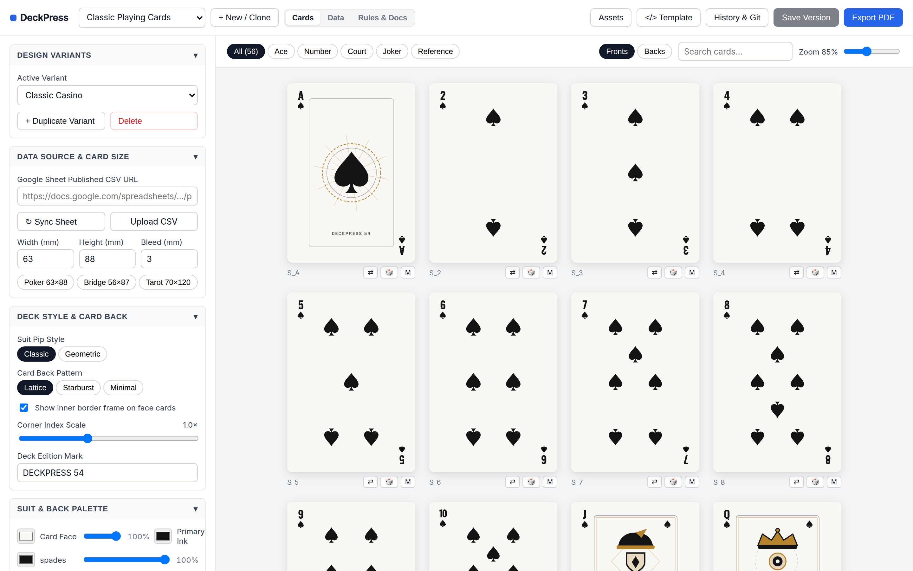
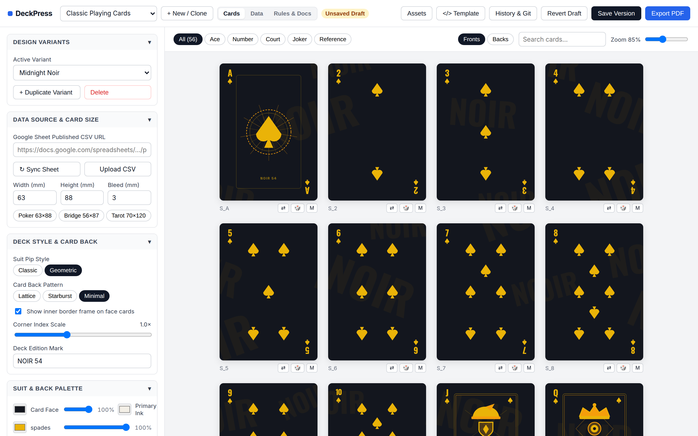
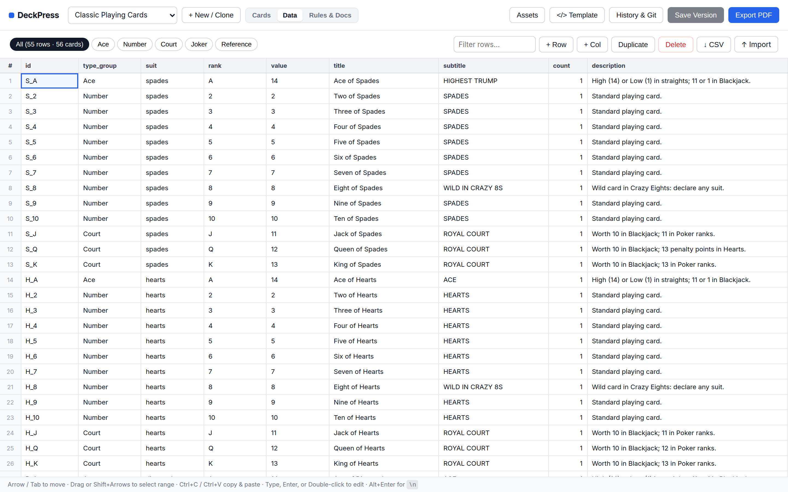
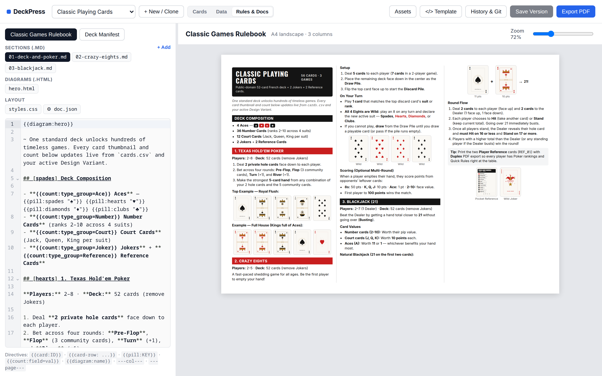

# DeckPress

Self-hosted, single-container tabletop card game design studio and print-ready PDF press.

Design data-driven card games from spreadsheets (built-in editor, CSV, or Google Sheets), customize layouts with live HTML/CSS/SVG templates and named design variants, write printable rulebooks with live card embeds, and export duplex print-ready PDFs via headless Chromium.



## Features

- **Game-Agnostic Data & Built-In Spreadsheet Editor:** Edit your deck directly in the Excel-like **Data** tab (`cards.csv`) with dynamic columns, row filtering, keyboard navigation, and `count` expansion — or sync live from a published Google Sheet CSV URL.
- **Project-Owned Modular Templates & Declarative Controls:** Each project owns its `template/` folder (`index.js`, `styles.css`, and helper `.js` modules loaded via `require('./...')`) and `controls.json` sidebar schema. Edit code live in the built-in CodeMirror 6 **`</> Template`** editor with instant preview and zero Docker rebuilds.
- **Named Design Variants & Live Drafts:** Experiment safely in browser drafts, switch between or duplicate named variants (e.g. *Classic Casino*, *Four-Color Tournament*, *Midnight Noir*), preview **Fronts** and **Backs**, and revert or commit versions with one click.
- **Deterministic Semi-Randomization & Pluggable Canvas:** Seeded PRNG (`mulberry32`) powers per-card procedural variations with hover **Re-roll** / lock controls, plus pluggable canvas layers (*Empty*, *SVG Icon Pattern*, *Connected Sheet Watermark*, or *Per-Card Uploaded Art*).
- **Rules & Docs Studio:** Author multi-column printable rulebooks in section-split Markdown (`docs/`) with live `{{card:...}}`, `{{card-row:...}}`, `{{count:field=val}}`, `{{pill:...}}`, and `{{diagram:...}}` embeds — or build programmatic manifests (`render.js`) that stay automatically in sync with your CSV.
- **1-Click Print-Ready PDF Export:** Server-side WYSIWYG Chromium rendering for both cards and docs, supporting custom card dimensions, bleed, **1 card per page** (MPC / print shop) or **packed sheets** (A4 / A3 / Letter / Custom), **Front / Back / Row-Mirrored Duplex** imposition, variable gaps, and optional corner crop marks or full cut grids.
- **Per-Project Git Repositories:** Each game lives in its own local Git repo under `projects/<slug>/` (gitignored from this app repo) with 1-click **Save Version**, commit history & rollback, project initialization (*Starter Template / Demo: Playing Cards / Blank / Clone Repo*), and optional Git remote Pull/Push.
- **Bundled Showcase Demo:** Ships with `examples/classic-playing-cards/` (a license-free 56-card French-suited poker deck with 3 variants, custom backs, SVG suit icons, pocket reference cards, rulebook, and deck manifest). Automatically seeded on first run when `projects/` is empty.

## Studio Screenshots

### Design Variants & Watermarks
Switch themes, palettes, pip styles, card backs, and connected sheet watermarks in one click:


### Built-In Data Editor
Edit card rows, add custom columns, filter by type group, or import/export CSV without leaving the browser:


### Rules & Docs Studio
Write printable multi-column rulebooks with live card thumbnails and dynamic `{{count:...}}` directives:


## Quick Start (Docker)

### Local
```bash
cp .env.example .env
docker compose up -d --build
```
Open `http://127.0.0.1:8080`. On first run with an empty data volume, DeckPress automatically seeds the **Classic Playing Cards** demo project.

### VPS (with Caddy + Basic Auth)
```bash
cp .env.example .env
npm run hash-password   # Paste the DECKPRESS_PASSWORD_HASH='...' line into .env
docker compose -f compose.vps.yaml up -d --build
```
`compose.vps.yaml` attaches to the external `web` network with `caddy-docker-proxy` and `homepage` labels and mounts `${DECKPRESS_DATA_PATH}:/data` (owned by uid `1000`).

## Local Development

```bash
npm install
npm run dev        # Fastify API server on :8080
npm run dev:client # Vite React Studio on :5173 (proxies /api to :8080)
npm test           # Unit tests for shared engine
npm run typecheck  # TypeScript typecheck
npm run build      # Build production client & server bundles
```

## Project Layout

Each card game lives in its own portable directory under `projects/<slug>/` (see `examples/classic-playing-cards/` for a full working example):

```text
projects/<slug>/
├─ project.json          # Metadata, optional Google Sheet URL, card dimensions & bleed
├─ cards.csv             # Dynamic card table (edited in Data tab or synced from Google Sheets)
├─ design.json           # Active variant + named design variants
├─ controls.json         # Declarative sidebar controls schema
├─ overrides.json        # Per-card locked seeds or layout overrides
├─ custom.css            # Optional quick CSS overrides
├─ template/             # Modular HTML/CSS/SVG card renderer (index.js, styles.css, *.js)
├─ docs/<doc-id>/        # Printable Markdown rulebooks & programmatic render.js manifests
└─ assets/               # Project-owned fonts (.ttf/.woff2), pattern SVGs, and card art
```

For architectural details and ADRs, see [docs/architecture.md](docs/architecture.md).
