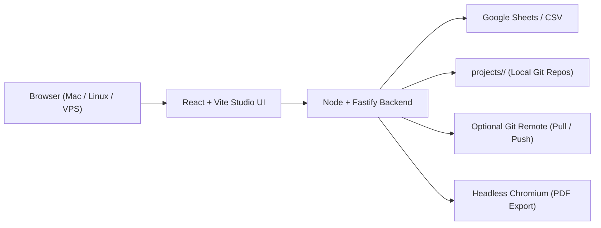

# Architecture

Map of the **Card Studio** system. Decisions and their rationale live in `docs/adr/`.

## Purpose and priorities
Card Studio is a self-hosted, single-container web application for creating data-driven, semi-randomized tabletop card games from spreadsheets (Google Sheets or CSV) and exporting print-ready PDFs.

Ranked priorities:
1. **Ease of use for non-coders** (browser-based Design Studio, spreadsheet data source, 1-click PDF export).
2. **Visual fidelity & creative flexibility** (exact typographic/Swiss card design, deterministic seeded semi-randomization, pluggable middle canvas: empty / SVG icon pattern / per-card artwork).
3. **Simple single-container deployment** (`node:20-alpine` + system Chromium, mounted `projects/` volume, optional password auth).

## Structure


## Modules
| Module | Responsibility | Exposes | Depends on |
|---|---|---|---|
| `client/` | Browser SPA: project switcher/initializer, card grid preview, live Design Studio (drafts & variants), per-card re-roll/lock, asset uploader, PDF export modal | Static bundle served by `server/` | `shared/`, `server/` REST API |
| `shared/` | Pure TypeScript card layout engine: CSV parser, seeded PRNG, deterministic semi-random layout generator, card data & `design.json` schema types | ES modules imported by both `client/` and `server/` | None |
| `server/` | Fastify HTTP server: static UI serving, optional Basic/token auth, Google Sheets CSV proxy, project CRUD & asset storage, local Git & remote sync, Chromium PDF export | REST API under `/api/*` + print route `/print/:slug` | `shared/`, `git` CLI, `puppeteer-core` + system Chromium |
| `projects/<slug>/` | Gitignored per-game data & design repositories (e.g., `projects/the-menu/`). Portable and independent of the app repo. | Files on mounted Docker volume | Managed by `server/` |

## Key flows
1. **Load & preview cards**: Browser requests `GET /api/projects/:slug` (loads `project.json`, `design.json`, `overrides.json`) and `GET /api/projects/:slug/cards` (fetches & caches Google Sheets CSV or local `cards.csv`). `shared/` computes deterministic per-card layout parameters from `(card.id, globalSeed, cardOverrideSeed, designRules)` and renders cards in HTML/CSS/SVG.
2. **Live design editing & safe experimentation**: Sliders, color pickers, typography, randomization ranges, and canvas mode (Empty / SVG Pattern / Artwork) mutate an in-memory **draft** in the browser for instant preview. Users can switch or clone **named variants** in `design.json`, revert to last saved state, or click **Save Version** (`PUT /api/projects/:slug/design` + `git commit`).
3. **Project initialization & Git sync**: Users create a project via Blank, Built-in Template, or **Clone Git Repo** (`POST /api/projects/clone`). Inside a project, users can view local commit history, rollback to any commit, and optionally connect/disconnect a remote URL to Pull or Push.
4. **1-click PDF export**: User picks card size, bleed, mode (*Individual 1-card-per-page* or *Sheet-pack A4/A3/Letter/Custom* with variable spacing), and cutting guidelines (*None / Crop marks / Cut grid*). `POST /api/projects/:slug/export/pdf` launches a page in headless Chromium against the server's `/print/:slug` view with exact `@page` mm dimensions and streams the resulting PDF back to the browser.

## Boundaries and contracts

### Per-project repository layout (`projects/<slug>/`)
```text
projects/the-menu/
├─ .git/                 # Local Git repo (optional remote)
├─ project.json          # Project metadata, Google Sheet URL / local CSV path, default card size
├─ design.json           # Active variant + named variants (colors, fonts, randomization rules, canvas mode)
├─ overrides.json        # Per-card locked seeds or layout overrides keyed by card.id
├─ custom.css            # Optional advanced CSS escape hatch
├─ cards.csv             # Fallback / local snapshot of card table
├─ assets/
│  ├─ fonts/             # Uploaded .woff2 / .ttf fonts
│  ├─ icons/             # Uploaded SVG food icons for procedural background patterns
│  └─ images/            # Per-card illustrations
└─ reference/            # Optional reference material (e.g., hand-made card photos)
```

### Core REST API (`server/`)
- `GET /api/projects` — list local projects in `projects/`
- `POST /api/projects` — initialize new project (`mode: "blank" | "template" | "clone"`, optional `repoUrl`, `token`)
- `GET /api/projects/:slug` — read `project.json`, `design.json`, `overrides.json`, `custom.css`, and git status/remote info
- `PUT /api/projects/:slug/config` — update `project.json` (sheet URL, card dimensions, name)
- `PUT /api/projects/:slug/design` — save `design.json`, `overrides.json`, `custom.css` (optional `commitMessage` creates a local git commit)
- `GET /api/projects/:slug/cards` — fetch & parse cards from configured Google Sheet URL (with local `cards.csv` fallback)
- `POST /api/projects/:slug/assets/:kind` — upload asset (`fonts` | `icons` | `images`)
- `GET /api/projects/:slug/git/log` — list local commits
- `POST /api/projects/:slug/git/rollback` — restore working files from a chosen commit (creates a clean revert/restore commit)
- `POST /api/projects/:slug/git/remote` — connect or disconnect remote URL (credentials stored outside the project repo or passed per-action, never committed)
- `POST /api/projects/:slug/git/pull` | `push` — sync with connected remote
- `POST /api/projects/:slug/export/pdf` — render & download PDF with `{ cardWidthMm, cardHeightMm, bleedMm, mode, sheetFormat, gapMm, guidelines, variant, draftDesign? }`

## Risks and open questions
- **Fonts for `the-menu`**: The reference images use condensed bold display sans (similar to Bebas Neue / Oswald / Impact), light italic sans for tags, and playful script/display fonts for `"menu"`. We should bundle/load clean open-source equivalents (e.g., Google Fonts / local `.woff2` in `assets/fonts/`) with full Slovak diacritics (`á, č, ď, é, í, ĺ, ľ, ň, ó, ô, ŕ, š, ť, ú, ý, ž`) and let the user swap them in the UI.
- **Git credentials security**: Remote tokens must never be written inside `projects/<slug>/.git/config` if the user exports the folder, or should be clearly separated/redacted when disconnecting a remote.
- **VPS memory during PDF export**: Headless Chromium PDF generation should run through a single-concurrency queue on the server so two simultaneous exports don't OOM a 1 GB VPS.

## Decisions
- [ADR-0001: Replace Jubbly with a Dedicated Single-Container Card Studio Web App](adr/0001-dedicated-card-studio-app.md)
- [ADR-0002: Server-Side PDF Export via Alpine Linux and System Chromium](adr/0002-pdf-export-alpine-chromium.md)
- [ADR-0003: Separate Project Storage with Local Git Versioning and Optional Remote Sync](adr/0003-project-storage-and-local-git.md)
