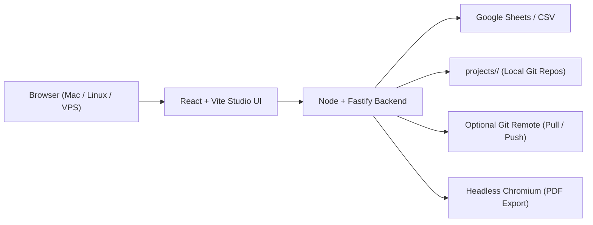

# Architecture

Map of the **DeckPress** (`deckpress`) system. Decisions and their rationale live in `docs/adr/`.

## Purpose and priorities
DeckPress is a self-hosted, single-container web application for creating data-driven, semi-randomized tabletop card games from spreadsheets (Google Sheets or CSV) and exporting print-ready PDFs.

Ranked priorities:
1. **Ease of use for non-coders** (browser-based Design Studio, spreadsheet data source, 1-click PDF export).
2. **Visual fidelity & creative flexibility** (project-owned HTML/CSS/SVG templates, deterministic seeded semi-randomization, pluggable middle canvas: empty / SVG icon pattern / watermark / per-card artwork).
3. **Simple single-container deployment** (`node:20-alpine` + system Chromium, mounted `projects/` volume, optional scrypt password auth).

## Structure


## Modules
| Module | Responsibility | Exposes | Depends on |
|---|---|---|---|
| `client/` | Browser SPA: `Cards` studio (live drafts, variants, fronts/backs toggle, per-card re-roll), Excel-like `Data` spreadsheet editor (`cards.csv`), `Rules & Docs` studio (Markdown/code editor + live preview + `doc.json` settings), CodeMirror 6 template editor, asset uploader, context-aware PDF export modal | Static bundle served by `server/` | `shared/`, `server/` REST API |
| `shared/` | Pure game-agnostic TypeScript engine: dynamic CSV parser/serializer (`csv.ts`), seeded PRNG & color helpers (`prng.ts`, `layout.ts`), project template runtime (`runtime.ts`), print/duplex sheet imposition (`print.ts`), Markdown + directive doc renderer (`docs.ts`), types (`types.ts`) | ES modules imported by both `client/` and `server/` | None |
| `server/` | Fastify HTTP server: static UI serving, optional Basic/token auth, Google Sheets CSV proxy, project CRUD & asset storage, local Git & remote sync, Chromium card & doc PDF export | REST API under `/api/*` | `shared/`, `git` CLI, `puppeteer-core` + system Chromium |
| `projects/<slug>/` | Gitignored per-game data, templates, docs & asset repositories (e.g., `projects/the-menu/`). Portable and independent of the app repo. | Files on mounted Docker volume | Managed by `server/` |

## Key flows
1. **Load & preview cards / data**: Browser requests `GET /api/projects/:slug` (loads `project.json`, `design.json`, `overrides.json`, `controls.json`, `template/`, `docs/`, and custom fonts/assets) and `GET /api/projects/:slug/cards` (parses `cards.csv` or Google Sheet preserving exact column order). The project's `template/index.js` renders card fronts and optional `renderCardBack()` backs.
2. **Live editing & safe experimentation**: Users can edit design controls, spreadsheet cells (`Data` tab), template code (`</> Template`), and rulebooks/docs (`Rules & Docs` tab) in live browser drafts. Users can switch or clone **named variants** in `design.json`, revert drafts, or click **Save Version** (`PUT /api/projects/:slug/design` + `git commit`).
3. **Project initialization & Git sync**: Users create a project via Blank, Built-in Template, or **Clone Git Repo** (`POST /api/projects/clone`). Inside a project, users can view local commit history, rollback to any commit, and optionally connect/disconnect a remote URL to Pull or Push.
4. **1-click PDF export**: In `Cards`/`Data` view, `POST /api/projects/:slug/export/pdf` renders selected card types (`front`, `back`, or row-mirrored `duplex`) via headless Chromium with exact `@page` mm dimensions, bleed, and cutting guidelines (*None / Crop marks / Cut grid*). In `Rules & Docs` view, `POST /api/projects/:slug/export/doc` renders the active project document (`docs/<id>/`) to PDF.

## Boundaries and contracts

### Per-project repository layout (`projects/<slug>/`)
```text
projects/the-menu/
├─ .git/                 # Local Git repo (optional remote)
├─ .env                  # Gitignored, write-only server Git token (0600)
├─ project.json          # Project metadata, optional Google Sheet URL, default card size
├─ design.json           # Active variant + named variants (values for controls)
├─ controls.json         # Declarative sidebar controls schema for this game
├─ template/             # Modular project-owned renderer (or legacy single-file renderer.js)
│  ├─ index.js           # Entry point exporting getBaseCss(), renderCard(), optional renderCardBack()
│  ├─ styles.css         # Template stylesheet (loaded via readFile('./styles.css'))
│  └─ *.js               # Optional helper modules (card types, backs, overview cards, etc.)
├─ docs/                 # Project-owned printable documents (rules, card lists, overviews)
│  └─ <doc-id>/
│     ├─ doc.json        # Page size, margins, zoom bounds, tab order, section list
│     ├─ styles.css      # Document print & preview styles
│     ├─ render.js       # Optional programmatic HTML generator (e.g. auto card list)
│     └─ sections/*.md   # Section-split Markdown with {{card:}}, {{count:}}, {{pill:}}, {{diagram:}}
├─ overrides.json        # Per-card locked seeds or layout overrides keyed by card.id
├─ custom.css            # Optional advanced CSS escape hatch
├─ cards.csv             # Primary / local snapshot of card table (dynamic columns)
└─ assets/
   ├─ fonts/             # Project-owned .woff2 / .ttf fonts (auto-registered via @font-face)
   ├─ icons/             # Uploaded SVG icons for procedural background patterns
   └─ images/            # Per-card illustrations
```

### Core REST API (`server/`)
- `GET /api/projects` — list local projects in `projects/`
- `POST /api/projects` — initialize new project (`mode: "blank" | "template" | "clone"`, optional `repoUrl`, `token`)
- `GET /api/projects/:slug` — read `project.json`, `design.json`, `overrides.json`, `controls.json`, `template/`, `docs/`, `custom.css`, assets, and git status/remote info
- `PUT /api/projects/:slug/config` — update `project.json` (sheet URL, card dimensions, name)
- `PUT /api/projects/:slug/design` — save `design.json`, `overrides.json`, `custom.css`, `docs/`, and/or `cards.csv` (optional `commitMessage` creates a local git commit)
- `GET /api/projects/:slug/cards` — fetch & parse `{ columns, rows, cards }` from local `cards.csv` or configured Google Sheet URL
- `POST /api/projects/:slug/assets/:kind` — upload asset (`fonts` | `icons` | `images`)
- `GET /api/projects/:slug/git/log` — list local commits
- `POST /api/projects/:slug/git/rollback` — restore working files from a chosen commit (creates a clean revert/restore commit)
- `POST /api/projects/:slug/git/remote` — connect or disconnect remote URL (credentials stored outside the project repo or passed per-action, never committed)
- `POST /api/projects/:slug/git/pull` | `push` — sync with connected remote
- `POST /api/projects/:slug/export/pdf` — render & download card PDF (supports `sides: "front" | "back" | "duplex"`, `filterTypes`, bleed, sheet packing, crop marks/cut grid)
- `POST /api/projects/:slug/export/doc` — render & download project document PDF (`docs/<id>/`)

## Risks and open questions
- **Fonts**: DeckPress core bundles 4 neutral UI/fallback sans-serif fonts (`Inter`, `Barlow Condensed`, `Oswald`, `Space Grotesk` via `@fontsource/*`, full Latin-Extended support). Game-specific display/script/custom fonts live in each project's `assets/fonts/` (`.ttf`/`.woff2`) and are auto-registered for both browser preview and offline Chromium PDF export.
- **Git credentials security**: Remote tokens are stored in gitignored `projects/<slug>/.env` (`0600`), never inside `.git/config` or committed files.
- **VPS memory during PDF export**: Headless Chromium PDF generation runs through a single-concurrency queue on the server so simultaneous exports don't OOM a small VPS.

## Decisions
- [ADR-0001: Replace Jubbly with a Dedicated Single-Container Card Studio Web App](adr/0001-dedicated-card-studio-app.md)
- [ADR-0002: Server-Side PDF Export via Alpine Linux and System Chromium](adr/0002-pdf-export-alpine-chromium.md)
- [ADR-0003: Separate Project Storage with Local Git Versioning and Optional Remote Sync](adr/0003-project-storage-and-local-git.md)
- [ADR-0004: Move Card Rendering Logic and Sidebar Controls into Each Project](adr/0004-project-owned-renderer-and-controls.md)
- [ADR-0005: Project-Owned Markdown Rules, Live Card Embeds, and Native Overview Cards](adr/0005-markdown-rules-and-overview-cards.md)
- [ADR-0006: Game-Agnostic Core Engine](adr/0006-game-agnostic-engine.md)
